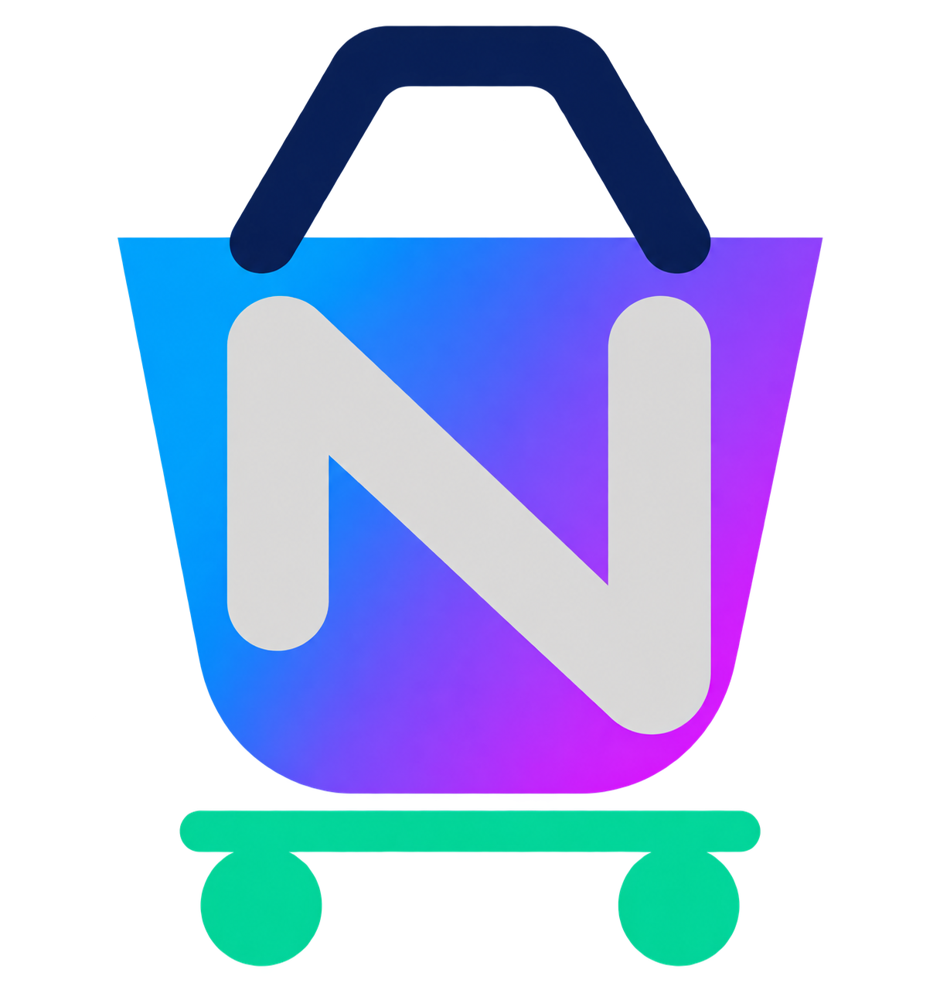
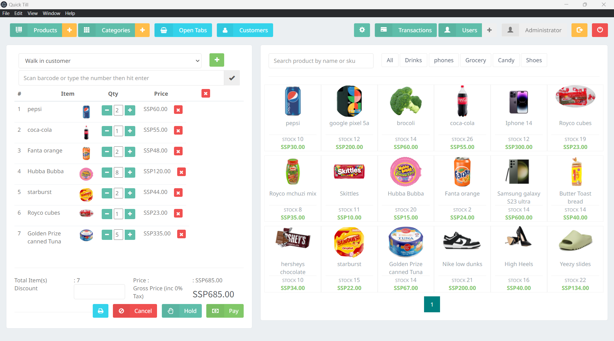
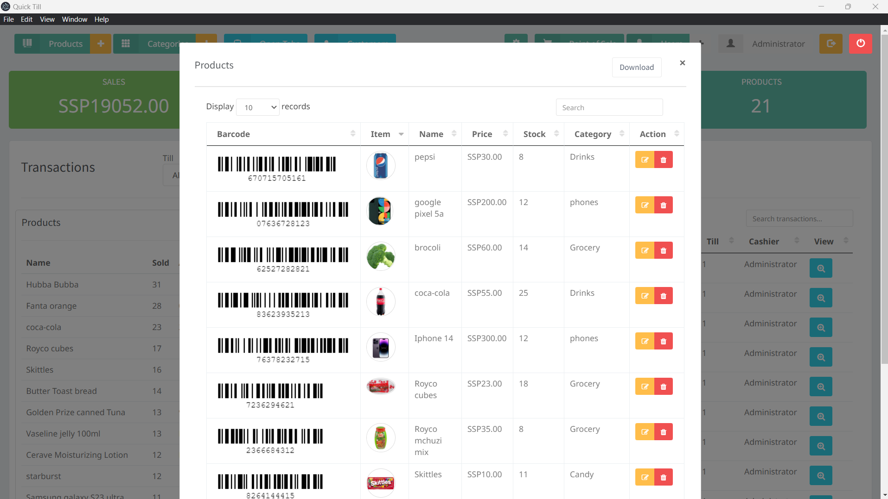
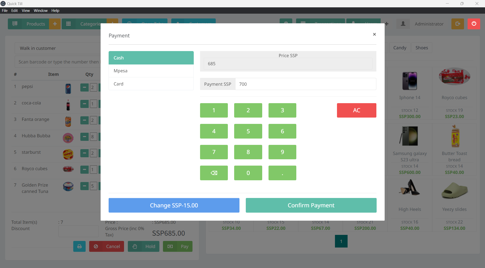
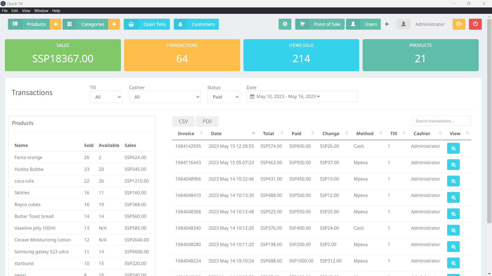
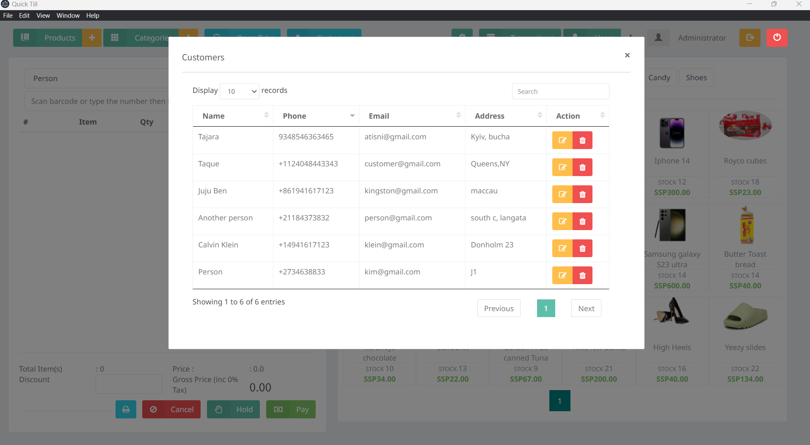
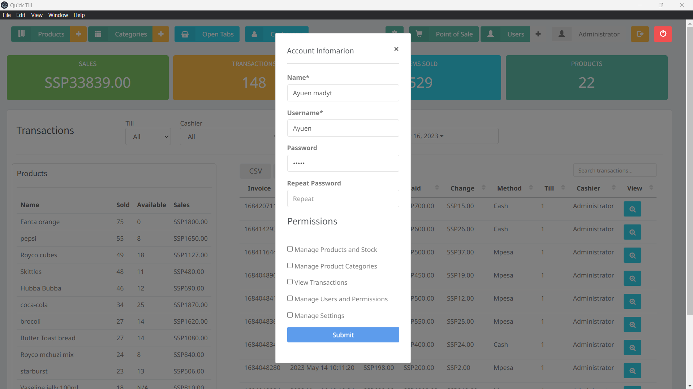
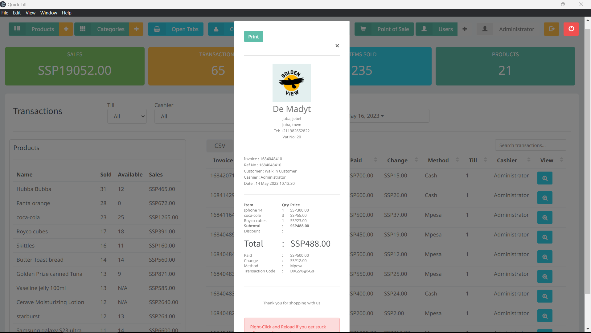

<div align="center">

  

  # NEXORA POS

  **A modern, offline-first desktop Point of Sale system for shops, canteens and small businesses, built with Electron and Node.js. It can back up to Google Drive automatically.**

  [](#-release-notes)
  [](https://nodejs.org/)
  [](https://www.electronjs.org/)
  [](#-building--packaging)
  [](#%EF%B8%8F-google-drive-backup)
  [](https://www.gnu.org/licenses/agpl-3.0.html)

</div>

---

<div align="center">
  
</div>

---

## 📋 Table of Contents

- [Overview](#-overview)
- [Key Features](#-key-features)
- [Google Drive Backup](#%EF%B8%8F-google-drive-backup)
  - [How it works](#how-it-works)
  - [One-time Google Cloud configuration](#one-time-google-cloud-configuration)
  - [Connect Nexora to Google Drive](#connect-nexora-to-google-drive)
  - [Everyday use](#everyday-use)
  - [Restoring from Google Drive](#restoring-from-google-drive)
  - [Privacy & security](#privacy--security)
  - [Google Drive troubleshooting](#google-drive-troubleshooting)
- [First-Run Setup](#-first-run-setup)
- [User Permissions](#-user-permissions)
- [Prerequisites](#%EF%B8%8F-prerequisites)
- [Quick Start & Installation](#-quick-start--installation)
- [Available Scripts](#-available-scripts)
- [Building & Packaging](#-building--packaging)
- [Project Architecture](#-project-architecture)
- [Data Storage, Backup & Reset](#-data-storage-backup--reset)
- [Screenshots](#%EF%B8%8F-screenshots)
- [Troubleshooting & FAQs](#-troubleshooting--faqs)
- [Release Notes](#-release-notes)
- [Contributing](#-contributing)
- [License](#-license)

---

## 🌟 Overview

**NEXORA POS** is a desktop Point of Sale application for retail shops, canteens and small-to-medium businesses. Everything runs on the shop's own PC: an embedded **NeDB** datastore and an internal **Express** API server on port `8001`, inside an **Electron** window. It needs no database installation and no internet connection to sell.

It covers the whole day of a small business:
- **Selling:** till, bills, returns and exchanges.
- **Customers:** credit and advances.
- **Stock:** products, purchases from suppliers (GRN), returns to suppliers (PRN) and stock adjustments.
- **Money:** expenses, the Quick Journal, Day End and Accounts.

Your data stays safe with local backups and automatic **Google Drive backup**, which uploads whenever the internet is connected.

It runs on a single checkout PC, or across several tills on a local network (LAN) sharing one database.

---

## ✨ Key Features

### 🛒 Point of Sale
- Product tiles in a grid with pictures (or a coloured initial), price, stock badge and **category filter**. Every category gets a button, including ones with nothing in stock.
- Fast **barcode scanning** and search by name or code.
- Products with the same name share one tile; the cashier picks the price, or scans that product's own barcode.
- **Current Bill** panel with customer selection, quantities, discount, VAT and live totals.
- **Hold** orders as open tabs and serve several customers at once.
- **Return / Refund** and **Exchange** against earlier bills.
- Print the bill **before payment**. It is clearly marked *NOT PAID YET* or *PAYMENT NOT CONFIRMED*.

### 💳 Payments
| Method | Notes |
| :--- | :--- |
| **Cash** | Change worked out automatically; a registered customer can keep the extra as **advance** |
| **Card** / **Bank Transfer** | With a reference |
| **Credit** | Registered customers only, checked against their **credit limit** |
| **Partial payment** | Part paid now by Cash, Card or Bank Transfer, the rest on credit |

Card, Bank Transfer, Return / Refund and Exchange can each be turned off in **Settings → Payments & Operations**.

### 👤 Customers, Credit & Advance
- Customer register with **unlimited** or **limited** credit.
- **Settle Credit** with a printed receipt. Overpayment is kept as advance and used automatically on the next bill.
- **Customer Transactions** window with Transactions, Credit payments and Advance tabs, each with date filter, search and Excel / PDF export.

### 📦 Products, Categories & Stock
The **Products** window has four tabs: Products, Categories, **Brands** and Stock Adjustments.
- **Products:**
  - **Brand**, **Size / Variant** (500 ml, Large…), **Unit** (piece, bottle, pack, plate…), **SKU / item code**, description and a per-product **low-stock alert**. Products with the same name in different sizes share one till tile, and the cashier picks the size. The SKU can be typed into the scan box.
  - Cost price and selling price, with live profit and margin shown as you type.
  - Barcode, entered or generated with **Fill**, stock and picture.
  - Printable **barcode labels** with the price.
- **Brands:** **Add Brand** (or **+ New** next to Brand in the product form, like Expense Type in the expense form) - every brand with its products, sizes, units in stock and stock value at cost and selling price, with Excel / PDF export. Open a brand to see its products and edit them; **Rename** fixes a brand's spelling on all its products at once, or merges two brands (e.g. "Nestle" into "Nestlé").
- **Product History:** every sale, return, GRN, PRN, adjustment and edit for a product, plus its stock batches.
- **Stock Adjustments:**
  - Stock out (Expired, Damaged, Lost / Missing, Theft, Own / Staff use, Stock count shortage) or stock in (Stock count surplus, Found).
  - Valued at cost, with a printable note.
- Low-stock and out-of-stock alerts. A product that tracks stock and has none left has no tile at the till.

### 🚚 Suppliers, GRN & PRN
- **Suppliers** page:
  - Supplier register with total purchases, amount **owed** and **advance**, per supplier.
  - **Supplier Transactions** window listing GRNs, PRNs and payments with the running balance, plus **Pay Supplier** / **Pay in Advance**.
- **Goods Received Notes (GRN):**
  - Goods from a supplier or walk-in seller, paid by Cash, Bank Transfer, Card, Credit or the supplier's advance.
  - Saving adds the stock.
  - **One product per cost price:** goods go to the product with the same name, category and cost price. At a new cost price, the GRN creates a **new product** with its own selling price and barcode; the form suggests a price that keeps the margin.
  - **GRN details** window with **Print Bill** and **Print Labels**.
- **Purchase Return Notes (PRN):**
  - Goods sent back, optionally **against a GRN** (only its products, at the cost paid, no more than it brought in).
  - Refunded by Cash, Bank Transfer or Card, or **deducted from the supplier's balance**. A GRN bought on credit is always deducted.
  - **PRN details** window, the same as GRN details: products, settlement, supplier balance before → after, reason, and **Print Bill**.

### 💸 Expenses
- **Expenses** page with your own expense types (Rent, Electricity, Salaries...).
- Date, amount, type, payment method and description.
- Filters, totals per method, and Excel / PDF export.

### 📒 Quick Journal, Day End & Accounts
- **Quick Journal (page):** everything that happened on one day, in time order:
  - sales, returns, credit and advance payments, expenses, GRNs, PRNs, stock adjustments and money transfers;
  - totals, plus money in / out / net per payment method;
  - open the bill behind any entry, export, or print the day like a bill.
- **Day End:**
  - what each payment method took in and paid out;
  - **move money between methods** (cash banked, card takings settled into the bank...) with a printed note;
  - print the Day End report.
- **Accounts (page):** every transaction posted to the accounts it touches:
  - Cash, Card, Bank, Customer Credit and Advances, Supplier Credit and Advances, Sales, GRN Purchases, Purchase Returns, Expenses and Stock Adjustments;
  - an overview and a statement per account for any period.

### 📊 Transactions & Profit
- **Transactions page** with Cashier, Status, Payment Method and date filters, totals (Sales, Transactions, Items sold, Products), and a "Products Sold" side list.
- **Profit tab:** cost, profit and margin for its own date range.

### 🧾 Bills & Printing
One clean, receipt-printer-friendly design for every document: **sale bill, GRN, PRN, credit receipt, supplier payment, stock adjustment, money transfer, Quick Journal and Day End**.
- Each has the store header, a title band, the details, an items table with totals, and a payment or settlement block.
- GRN, PRN and the other supplier and stock notes add signature lines.
- Logo, store details, VAT number and receipt footer come from **Settings**.

### 🖥️ Interface
- **Pages:** Point of Sale, Transactions, Expenses, Suppliers, Quick Journal and Accounts. They're fixed to the window, so only the lists scroll.
- **Toolbar:** buttons stay in place, and the open page or window is highlighted.
- **Windows:** green headers and rounded corners throughout.
- **Tooltips** on every button (mouse and keyboard; not shown for touch taps).
- A **loading bar and spinner** whenever data takes a moment to load or save.
- **Excel (`.xlsx`)** and **PDF** export on every list.

### 💾 Your data is safe
- **Google Drive backup:** automatic, uploads whenever the internet is connected (see below).
- **Backup / Restore** to any folder, and a choice of **data location**.
- **Reset Database:** start fresh but keep the user accounts, with a backup made first.

### 🌐 Multi-Till Network
- Run the main PC as the server (port `8001`); other tills connect over the LAN and share products, customers and live stock.

---

## ☁️ Google Drive Backup

Nexora can keep a copy of **all your data** (products, sales, customers, suppliers, settings and images) in **your own Google Drive**. It backs up by itself, and **uploads whenever the internet is connected**. While the PC is offline, backups are saved on the PC and go up as soon as the connection is back.

### How it works

```
 data changes ──► snapshot (zip) saved on this PC ──► uploaded to Google Drive
                  <data folder>/Nexora-Backups/        "Nexora Backups" folder
                  drive-queue/                         (when online)
```

- **When it backs up:**
  - right after you sign in (the first backup);
  - a minute or two after data changes;
  - at least every 10 minutes while the till is busy;
  - when the app closes.
- **Offline:** each backup is saved on the PC straight away, so nothing is lost. Only the newest one waits, since each backup holds all the data.
- **Upload:** as soon as the internet is connected, including the moment the connection comes back.
- **Retries:** if an upload fails, Nexora tries again after 1, 2, 4… up to 30 minutes.
- **In your Drive:** a folder called **`Nexora Backups`** holds files named `Nexora-Backup-<PC name>-<date_time>.zip`.
- **Kept:** for each PC, the **20 newest** backups plus **one per day for the last 30 days**. Older ones are deleted automatically. Another PC's backups are never touched.

### One-time Google Cloud configuration

Google requires every app that uploads to Drive to have its own free **OAuth client**. You create it once, in about 5 minutes, with the Google account that will hold the backups.

> [!NOTE]
> Google Cloud is free for this. No billing account or credit card is needed to use the Google Drive API with your own Drive.

**1. Create a project**
1. Open the [Google Cloud Console](https://console.cloud.google.com/) and sign in with your Google account.
2. Click the **project picker** at the top, then **New Project**.
3. Name it, for example `NexoraPOS`, and click **Create**. Make sure the new project is **selected** in the project picker.

**2. Turn on the Google Drive API**
1. Open [APIs & Services → Library → Google Drive API](https://console.cloud.google.com/apis/library/drive.googleapis.com).
2. Click **Enable**.

**3. Set up the consent screen (Google Auth Platform)**
1. Open [Google Auth Platform](https://console.cloud.google.com/auth/overview) and click **Get started**.
2. Fill in:
   - **App information:** App name `NexoraPOS`, User support email = your e-mail.
   - **Audience:** **External**.
   - **Contact information:** your e-mail.
   - Tick the agreement and click **Create**.
3. *(Optional, recommended)* Open [Data Access](https://console.cloud.google.com/auth/scopes), click **Add or remove scopes**, tick `.../auth/drive.file`, then **Update** and **Save**. Nexora asks only for this scope: access to the files it creates itself.

**4. Publish the app ⚠️ (important)**
1. Open [Audience](https://console.cloud.google.com/auth/audience).
2. Under **Publishing status: Testing**, click **Publish app**, then **Confirm**. The status must change to **In production**.

> [!IMPORTANT]
> If you skip this step, Google blocks the sign-in with **"Access blocked: NexoraPOS has not completed the Google verification process – Error 403: access_denied"**. Even if you add yourself as a *test user* instead, Google signs Nexora out **every 7 days** while the app is in Testing.
>
> Nexora only uses non-sensitive scopes (`drive.file`, `openid`, `email`), so publishing should **not** need a Google review.

**5. Create the OAuth client**
1. Open [Clients](https://console.cloud.google.com/auth/clients) and click **Create client**.
2. **Application type: Desktop app**. It must be *Desktop app*; a *Web application* client fails with `redirect_uri_mismatch`.
3. Name it, for example `Nexora Desktop`, and click **Create**.
4. Copy the **Client ID** (`123456-abc...apps.googleusercontent.com`) and the **Client secret** (`GOCSPX-...`). You can also **Download JSON** to keep them.

> [!WARNING]
> Keep the Client secret and the downloaded `client_secret_*.json` file out of the project folder and out of git. `.env` and `client_secret*.json` are listed in `.gitignore` for this reason.

### Connect Nexora to Google Drive

1. In Nexora, open **Settings → Data & Backup → Google Drive Backup**. The card also shows the steps above, with links.
2. Paste the **Client ID** and **Client secret** and click **Save**.
3. Click **Sign in with Google**. Your web browser opens Google's sign-in page.
4. Choose the Google account. If you're signed in to several accounts, pick the right one, or use **Use another account**.
5. If Google shows *"Google hasn't verified this app"*, click **Advanced → Go to NexoraPOS (unsafe)**. It's your own app.
6. Allow access to *"See, edit, create and delete only the specific Google Drive files you use with this app"*.
7. The browser shows **"Signed in to Google Drive"**. Close the tab and go back to Nexora.
8. Nexora makes the **first backup** straight away. From now on it backs up automatically.

> [!TIP]
> **Developers:** the Client ID and secret can also come from a `.env` file in the project folder when running from source:
> ```env
> GOOGLE_CLIENT_ID=123456-abc.apps.googleusercontent.com
> GOOGLE_CLIENT_SECRET=GOCSPX-...
> ```
> Values saved in Settings take priority over `.env`.

### Everyday use

**Settings → Data & Backup → Google Drive Backup** shows:

| Item | Meaning |
| :--- | :--- |
| Account | The Google account backups go to |
| Switch | Automatic backups on / off |
| Status | Backed up · Changes waiting · Upload waiting (next try) · Offline · Needs attention |
| Internet / Last upload / Waiting | Connection, the last successful upload, a backup saved on this PC that hasn't uploaded yet |
| **Back up now** | Save and upload a backup immediately (offline: saved, then uploads when online) |
| **Restore from Google Drive...** | Bring back any backup (see below) |
| **Open in Drive** | Opens the `Nexora Backups` folder in your browser |
| **Sign out** | Stops backups and revokes Nexora's access (backups already in Drive stay) |

The **cloud icon in the toolbar**, next to the user button, shows the state at a glance. Hover over it for details, or click it to open these settings.

| Icon | State |
| :--- | :--- |
| 🟢 green | Backed up |
| 🔵 blue | Backing up, or changes / an upload waiting |
| 🟠 orange + dot | Offline: backups wait on this PC and upload when the internet is back |
| 🔴 red + dot | Needs attention, e.g. sign in again or Google Drive is full |
| ⚪ grey + dot | Not set up / not signed in / turned off |

The icon is shown to users with the **Manage Settings** permission. It isn't shown on network terminals, whose data lives on the server PC; set up the backup on the server PC.

### Restoring from Google Drive

1. **Settings → Data & Backup → Restore from Google Drive...**
2. Pick a backup. The list shows the date and time, which PC made it, and its size, newest first. Backups from other PCs can be restored too.
3. Confirm **Restore & Restart**.

What happens:
1. The backup is downloaded and checked.
2. A copy of your **current data** is saved first, to `<data folder>/Nexora-Backups/Nexora-Backup-Before-Restore-<date>/`.
3. The app restarts and swaps the restored data in before the databases open.

To undo a restore, use **Restore Data** on that "Before-Restore" folder.

### Privacy & security

- **Only Nexora's own files:** the `drive.file` scope lets Nexora see **only the files it created**, never the rest of your Drive.
- **Encrypted sign-in:** the sign-in (refresh token) is stored encrypted with the operating system's protection (Electron `safeStorage`: DPAPI on Windows, Keychain on macOS), in the app's settings outside the data folder.
- **Secure sign-in flow:** sign-in uses your normal browser with **PKCE** and a one-time local address (`http://127.0.0.1:<port>`). Nexora never sees your Google password.
- **Client secret:** for a *Desktop app* client, Google doesn't treat the Client secret as confidential. It is stored in the app's settings on this PC.
- **Revoking access:** **Sign out** revokes the access. You can also remove it any time at [myaccount.google.com/permissions](https://myaccount.google.com/permissions).

### Google Drive troubleshooting

| Message / problem | Cause and fix |
| :--- | :--- |
| **Access blocked: NexoraPOS has not completed the Google verification process – Error 403: access_denied** / *"The app is currently being tested and can only be accessed by developer-approved testers"* | The app is still in **Testing**. Fix it in **the project that owns the Client ID** (the number at the start of the Client ID is the project number): [Audience](https://console.cloud.google.com/auth/audience) → **Publish app → Confirm** until it says **In production**. Or add the exact Gmail you sign in with under **Test users** and click **Save**. Then in Nexora click **Cancel** and **Sign in with Google** again. If the browser is signed in to another account, choose the right one, or use a private window. |
| *"Google hasn't verified this app"* | Normal for your own app: **Advanced → Go to NexoraPOS (unsafe)**. |
| `Error 400: redirect_uri_mismatch` | The OAuth client is not a **Desktop app**. Create a new client of type *Desktop app* and paste its ID and secret. |
| `invalid_client` / *"The OAuth client was not found"* | Wrong or deleted Client ID or secret. Copy them again from [Clients](https://console.cloud.google.com/auth/clients) and click **Google client settings** in Nexora to update them. |
| *Access Not Configured* / *Google Drive API has not been used in project…* | The **Google Drive API** isn't enabled in that project (step 2). |
| Signed out every 7 days | The app is still in **Testing**. Publish it (step 4). |
| *"Google did not give Nexora lasting access"* | Remove Nexora at [myaccount.google.com/permissions](https://myaccount.google.com/permissions), then sign in again. |
| *"Sign in to Google again"* (red icon) | The access was removed or expired. **Sign out**, then **Sign in with Google**. |
| *"Your Google Drive is full"* | Free up space in Google Drive. The waiting backup uploads by itself afterwards. |
| Orange icon / *Offline* | No internet. Nothing to do: backups wait on the PC and upload when the connection is back. |
| Waiting forever on *"Finish signing in in your browser…"* | The browser page was closed or Google showed an error. Click **Cancel** and sign in again. The sign-in times out after 5 minutes. |

---

## 🔐 First-Run Setup

There is no built-in default login. The first time NEXORA POS starts on a machine (when no user accounts exist yet), it shows a **Welcome** screen to create the administrator account:

| Field | Rules |
| :--- | :--- |
| **Full name** | Required |
| **Username** | 3–30 characters: letters, numbers, dot, dash or underscore |
| **Password** | At least 6 characters, entered twice to confirm |

The administrator gets **full access** and is logged in straight away. Next:
1. **Settings → Store / Tax & Currency / Payments & Operations / Receipt & Logo:** your store details, currency, VAT, what the till allows, logo and receipt footer.
2. **Settings → Data & Backup:** set up [Google Drive Backup](#%EF%B8%8F-google-drive-backup).
3. **Users:** add staff accounts and their permissions.

> [!NOTE]
> The setup screen only appears while there are no user accounts, so it can't be used to take over an existing installation. **Reset Database** keeps user accounts, so it does not bring the setup screen back.

---

## 👥 User Permissions

Each user gets their own permissions (**Users → Edit → Permissions**). Only the administrator can change them.

| Permission | Allows |
| :--- | :--- |
| Manage Products and Stock | Add / edit products, stock adjustments |
| Manage Product Categories | Create, rename and delete categories |
| View Transactions | Bills, payments, products sold, returns / exchanges |
| View Profit | Cost, profit and margin on sales |
| Manage Expenses | Expenses and expense types |
| Manage Suppliers & GRN | Suppliers, GRNs, PRNs and supplier payments |
| Quick Journal, Day End & Accounts | Money in and out, transfers, accounts |
| Manage Users and Permissions | Add users and choose what they can do |
| Manage Settings | Store, receipt, tax, terminal, data & backup (incl. Google Drive) |

---

## ⚙️ Prerequisites

To run from source or build installers:

- **Node.js** `v16.14.0` or higher (tested with Node.js 18, 20, 22 and 24). Check with `node -v`.
- **npm** (included with Node.js) or **yarn**.
- **Git**.

The installed app (`Nexora Setup <version>.exe`) needs nothing else. Electron is bundled.

---

## 🚀 Quick Start & Installation

### 1. Clone the repository
```bash
git clone https://github.com/MohamedMusthaque/Nexora.git
cd Nexora
```

### 2. Install dependencies
```bash
npm install
```
*(or `yarn`)*

### 3. Run in development mode
```bash
npm run electron
```
*(or `yarn electron`)*

This starts the Express API server on `http://localhost:8001` and opens the Electron window, restarting on changes via `nodemon`.

### 4. First launch
On a new machine the app opens the **Welcome** screen. Create the administrator account (see [First-Run Setup](#-first-run-setup)), add your store details in **Settings**, and connect [Google Drive Backup](#%EF%B8%8F-google-drive-backup).

---

## 📜 Available Scripts

| npm | yarn | Description |
| :--- | :--- | :--- |
| `npm run electron` | `yarn electron` | Starts the app in development mode with nodemon |
| `npm run package-win` | `yarn package-win` | Builds the Windows packages |
| `npm run package-win:nsis` | `yarn package-win:nsis` | Builds the Windows NSIS installer (`.exe`) |
| `npm run package-win:zip` | `yarn package-win:zip` | Builds a portable Windows `.zip` |
| `npm run dist:mac` | `yarn dist:mac` | Builds a universal macOS package |
| `npm run dist:linux` | `yarn dist:linux` | Builds a Linux package |
| `npm run electron-build` | `yarn electron-build` | Runs electron-builder with the default configuration |

---

## 📦 Building & Packaging

The version number comes from `package.json` (currently **1.1.0**). To build the Windows installer and portable zip:

```bash
npx electron-builder --win --publish never
```

Output (in `dist/`):

| File | Purpose |
| :--- | :--- |
| `Nexora Setup <version>.exe` | One-click installer (installs for the current user) |
| `Nexora-<version>-win.zip` | Portable version: unzip and run `Nexora.exe` |
| `latest.yml`, `*.blockmap` | Used by the auto-updater |

Notes:
- **Configuration:** the packaging settings are in the `build` section of `package.json`, which takes priority over `electron-builder.yml`.
- **No local data in the installer:** local data folders (`server/`, `UsersmusthAppDataRoaming/`), screenshots and editor settings are excluded, so no databases or user accounts are packed into it.
- **Secrets:** the Google Client ID and secret are **not** built in. Each installation enters its own in **Settings → Data & Backup**. Don't leave a `.env` with secrets in the project folder when building, because `build.files` packs the project folder.
- **Uploading a release by hand:** name the installer `Nexora-Setup-<version>.exe` (with dashes) to match `latest.yml`, so auto-updates can find it.

---

## 📂 Project Architecture

```
Nexora/
├── api/                      # Express REST API (backend, port 8001)
│   ├── accounts.js           # Accounts & ledgers, worked out from the records (read only)
│   ├── adjustments.js        # Stock adjustments (stock in / out, valued at cost)
│   ├── categories.js         # Categories
│   ├── customers.js          # Customers, credit & advances
│   ├── expenses.js           # Expenses & expense types
│   ├── inventory.js          # Products, stock, batches & product history
│   ├── journal.js            # Quick Journal: a day's money events (read only)
│   ├── settings.js           # Store details & receipt settings
│   ├── suppliers.js          # Suppliers, GRNs, PRNs & supplier payments
│   ├── transactions.js       # Sales, returns, credit payments & reports
│   ├── transfers.js          # Money transfers between payment methods (Day End)
│   └── users.js              # Users, login, permissions & first-run setup
├── assets/
│   ├── css/                  # Bootstrap theme, components.css (UI), pages.css
│   ├── images/               # Logos & icons
│   ├── js/
│   │   ├── pos.js            # The app's front-end controller (pages, windows, bills)
│   │   ├── product-filter.js # Till category filter & search, pay pad
│   │   ├── loading.js        # Loading bar & spinner for slow requests
│   │   └── tooltips.js       # Tooltips on every button
│   └── plugins/              # DataTables, DateRangePicker, Chosen, ...
├── lib/
│   ├── dataConfig.js         # Data location, pending reset / restore, Drive settings
│   ├── driveBackup.js        # Google Drive backup: snapshots, upload queue, restore
│   └── googleDrive.js        # Sign in with Google (PKCE) & the Drive REST calls
├── screenshots/              # UI captures
├── index.html                # Main window layout
├── renderer.js               # Loads the front-end scripts
├── server.js                 # Express server entry point (port 8001)
├── start.js                  # Electron main process: window, backup / restore / reset, Drive backup
└── package.json              # Dependencies, build configuration & scripts
```

---

## 💾 Data Storage, Backup & Reset

### Where the data lives
- **Data folder:** `<UserHome>/Nexora/POS/` by default. You can change it in **Settings → Data & Backup → Current Data Location**.
  - `server/databases/*.db`: NeDB files (`inventory.db`, `users.db`, `customers.db`, `categories.db`, `transactions.db`, `settings.db`, `returns.db`, `credit_payments.db`, `customer_advances.db`, `product_history.db`, `expenses.db`, `expense_types.db`, `suppliers.db`, `grns.db`, `prns.db`, `supplier_payments.db`, `batches.db`, `stock_adjustments.db`, `money_transfers.db`, `brands.db`).
  - `uploads/`: product pictures and the receipt logo.
- **Backups made by the app:** `<UserHome>/Nexora/Nexora-Backups/`. This holds the safety copies taken before a reset or restore, and `drive-queue/`, where backups wait for upload.
- **App settings** (data location, Google Drive connection): the OS user-data folder (`app-config.json`), never inside the data folder.
- **Logs:** `<userData>/nexora.log`.

### Ways to keep your data safe
| Option | Where | How |
| :--- | :--- | :--- |
| **Google Drive Backup** | Your Google Drive | Automatic, uploads whenever online. [Set up ↑](#%EF%B8%8F-google-drive-backup) |
| **Backup Data** | Any folder or drive you choose | Manual: a timestamped copy of the `POS` folder |
| **Restore Data** | From a backup folder | Replaces all data and restarts |
| **Change Data Location** | Another drive or a network folder | Moves the data and restarts |

### Reset Database
**Settings → Data & Backup → Reset Database** wipes the shop's data so you can start fresh, for example after training:

| Cleared | Kept |
| :--- | :--- |
| Sales & transactions (bills, returns, credit payments, customer advances) | **User accounts** (usernames, passwords, permissions) |
| Customers | |
| Expenses and expense types | |
| Suppliers, GRNs, PRNs and supplier payments | |
| Products, categories, stock, batches, adjustments and product history | |
| Store settings (store name, receipt, tax, logo) and uploaded images | |

1. Type `RESET` to confirm.
2. A full backup is saved first to `<DataLocation>/Nexora-Backups/Nexora-Backup-Before-Reset-<date>/`.
3. The app restarts and clears the data during start-up, before the databases open.

> [!TIP]
> A reset can be undone with **Restore Data**: choose the `Nexora-Backup-Before-Reset-...` folder.

---

## 🖼️ Screenshots

<div align="center">

| Point of Sale | Products & Inventory |
| :---: | :---: |
|  |  |

| Payment | Transactions |
| :---: | :---: |
|  |  |

| Customers | Users & Permissions |
| :---: | :---: |
|  |  |

| Sales Graph | Bill Print Preview |
| :---: | :---: |
|  |  |

</div>

---

## ❓ Troubleshooting & FAQs

### Google Drive backup
See [Google Drive troubleshooting](#google-drive-troubleshooting).

### `yarn : The term 'yarn' is not recognized...`
You don't need Yarn. Use npm instead:
```bash
npm install
npm run electron
```

### `Lock file can not be created! Error code: 32`
Only one copy of Nexora can run at a time (so two don't fight over port `8001`).
- Close any open Nexora windows.
- On Windows, end any leftover `electron.exe` / `Nexora.exe` processes in Task Manager.
- Start again.

### `Error: listen EADDRINUSE: address already in use :::8001`
Another process is using port `8001`. In PowerShell:
```powershell
Get-Process -Id (Get-NetTCPConnection -LocalPort 8001).OwningProcess | Stop-Process -Force
```

### A change to the look (CSS) doesn't show
Reload the window: right-click → **Reload**. Changes to the main process (`start.js`, `lib/`) need a full restart of the app.

### The Welcome (setup) screen appears on a PC that already had data
The setup screen only shows when the app finds **no user accounts** in its data folder. This happens after a new Windows user profile, a deleted `POS` folder, or a data location on a drive that isn't connected.
- Reconnect the drive or folder and restart.
- Or bring the data back from a backup: finish the setup, then use **Settings → Data & Backup → Restore from Google Drive...** (or **Restore Data** for a folder backup).

### Build fails with `Device or resource busy` / `EBUSY`
A file in the build output is locked, often by OneDrive sync or antivirus when the project is inside a OneDrive folder.
```bash
npx electron-builder --win --publish never --config.directories.output=dist-1.1.0
```
Or pause OneDrive sync, restart the PC and delete the old `dist/` folder.

---

## 📝 Release Notes

### 1.1.0

**☁️ Google Drive Backup**
- Sign in with Google, then backups upload automatically whenever the internet is connected. Offline backups wait on the PC and go up when the connection returns.
- Restore any backup from Google Drive.
- A toolbar status icon shows the backup state.
- See [Google Drive Backup](#%EF%B8%8F-google-drive-backup).

**📦 Stock, suppliers & money**
- **Stock Adjustments:** write off expired, damaged or lost stock, or add found stock, valued at cost.
- **Purchase Return Notes (PRN):** optionally against a GRN, with a new **PRN details** window like the GRN details.
- **Day End:** totals per payment method and **money transfers** between methods.
- **Accounts:** every transaction posted to Cash, Card, Bank, customer and supplier credit and advances, sales, purchases and expenses, with a statement per account.
- **One product per cost price:** goods at a new cost price become a new product with its own price and barcode.

**🖥️ Interface**
- **Transactions** and **Quick Journal** are now full pages, alongside Expenses, Suppliers and Accounts.
- **Redesigned till:**
  - product tiles with pictures or coloured initials and stock badges;
  - every category shown in the filter;
  - category filtering fixed for numeric category ids.
- **Windows:**
  - a green header and rounded corners throughout: Products, Customers, Users, Settle Credit, Suppliers, GRN / PRN forms, Pay Supplier and more;
  - **Product** and **Customer** forms laid out in sections like the User window.
- **Bills:**
  - one design for sale bills, GRN, PRN, receipts and notes, with a Total column on sale bills;
  - the bill window's **Print** and **×** sit correctly at the left and right.
- **Toolbar:** buttons no longer disappear when clicked; the open page or window is highlighted.
- **Tooltips** on every button, and a **loading bar / spinner** while data loads.
- New multi-section **Settings** window, with **Payments & Operations** switches.

### 1.0.1

- **Customers & credit:** unlimited or limited credit, credit settlement with receipts, customer advance used on the next bill, and a Customer Transactions window.
- **Payments:** Bank Transfer and Credit methods, partial payment (part now, rest on credit), and a redesigned Payment window.
- **Products & profit:** cost and selling price, Profit report, Product History.
- **Transactions:** all sales listed by default, filters for cashier / status / payment method / date, and Excel / PDF exports everywhere.
- **Setup:** first-run Welcome screen (no default `admin` / `admin`), and Reset Database that keeps user accounts.
- **Removed:** M-Pesa and the Till filter.

---

## 🤝 Contributing

1. **Fork** the repository on GitHub.
2. **Create a branch:** `git checkout -b feature/amazing-feature`
3. **Commit** with a clear message: `git commit -m "feat: add amazing feature"`
4. **Push:** `git push origin feature/amazing-feature`
5. **Open a Pull Request** against the main repository.

Please never commit databases (`*.db`), `.env` files or Google OAuth client files.

---

## 📄 License

This project is licensed under the **GNU Affero General Public License v3.0 (AGPL-3.0)**. See the [AGPL v3.0 License](https://www.gnu.org/licenses/agpl-3.0.html) for full details.

---

<div align="center">
  Developed with ❤️ by <b>Mohamed Musthaque</b>
</div>
